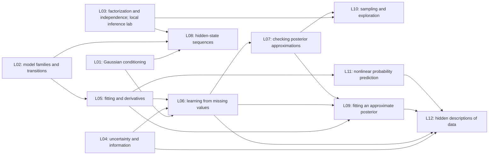

# Architecture audit: how the proposed lectures implement the course architecture

The authoritative intellectual purpose and planned progression are defined by [course_architecture.typ](../../course_architecture.typ) ([readable PDF](../../course_architecture.pdf)). This document **audits** individual proposed lecture scopes against that authority; it does not independently define the course's purpose. The central test is whether the proposed lecture names a real *family of learning problems* (experience, structure and scale of data, task and probabilistic query, performance requirement), **derives** the computational challenge from the resulting operation, accuracy target and resource limits, shows specifically what the previous machinery cannot accomplish, and defends the resulting *model, performance, or computational move* against plausible alternatives. Different methods may appropriately serve the same task under different distributional or resource conditions: do not fabricate unique applications or declare a method mathematically inevitable. The audit must expose weak connections rather than retroactively rationalize them, and check whether these capabilities accumulate coherently across the semester. This overview is for an instructor comfortable with probability, calculus, linear algebra and the course through roughly L03–L04, without assuming familiarity with the later Murphy material. The discussion identifies the mathematical stakes directly. The selective readings below provide the underlying derivations and background needed to examine an unfamiliar issue in detail.

The instructor agreed to the 13-meeting course order and agreed to L03’s graphical-model scope and simpler notebook image algorithm, and selected the L04 check-bit example. The remaining detailed choices await instructor review. [Teaching choices](questions_and_hesitations.md) explains the alternatives. [Review records](STATUS.md) separates instructor decisions from what agents have checked.

## What each lecture adds

L01's established Gaussian material and notebook are unchanged. L02's agreed exponential-family and character-sequence work is also unchanged; it is not recorded as delivered. Before producing later teaching material, we must check what L02 actually taught. Its old process notes are not a substitute for that check.

| Meeting | Mathematical focus | Notebook practice |
|---|---|---|
| L03 | Graphical models: factorization and conditional independence | Build a probabilistic restoration model from local factors, derive its posterior update, and distinguish local maximization from a global optimum or posterior marginal inference. |
| L04 | Information theory: mutual information, processing and noisy coding | In lecture distinguish detection from decoding with a three-bit parity code; in notebook extend to a five-bit code, prove its one-error correction guarantee and compare reliability, MI and rate. |
| L05 | Generalized linear models, automatic differentiation and SGD | Connect a likelihood derivative with reverse-mode automatic differentiation and a checked stochastic parameter-update/evaluation loop. |
| L06 | Latent-variable learning and expectation-maximization | Use conditional uncertainty in sufficient-statistic estimation and distinguish an exact EM improvement guarantee from arbitrary approximate hidden-value updates. |
| L07 | Bayesian computation: grid reference and Laplace approximation | Validate the numerical reference as well as the posterior approximation, and separate local curvature matching from global integral/prediction accuracy. |
| L08 | Exact inference in structured sequence models | Use sum-product dynamic programming to obtain exact sequence probabilities and marginals while controlling numerical scaling. |
| L09 | Variational inference: posterior geometry and pathwise gradients | Separate optimization error from variational-family error, and differentiate a parameter-dependent expectation with correct full-data likelihood/prior scaling. |
| L10 | Monte Carlo and MCMC: invariance, mixing and estimator error | Check transition validity separately from finite exploration and quantify uncertainty for a specified Monte Carlo query. |
| L11 | Neural conditional models: heteroskedastic likelihood and regularization | Implement and interpret a neural conditional likelihood, preserving standard-deviation/variance distinctions and the limits of fixed-weight predictive intervals. |
| L12 | Variational autoencoders: amortized inference and rate–distortion | Integrate amortized variational inference with a neural likelihood and assess a defined distortion/rate tradeoff without treating rate as mutual information or latent patterns as identified causes. |

L13 remains student project presentations. It is not an extra slot for unfinished mathematics.

## The mathematical route and the decisions it protects

**L03: how graphical assumptions organize a joint distribution.** Begin with L02’s Markov-chain factorization, derive the more general DAG factorization from the chain rule plus independence assumptions, and work Murphy’s student network to show parameter economy. Develop directed path-based independence, then introduce undirected local potentials, global normalization and ordinary separation. The collider/four-cycle contrast shows why the two graph languages express different independence structures. Define and interpret the binary Ising model live. Students construct the image prior, Gaussian likelihood, posterior and single-site conditional in the notebook, then implement a locally improving restoration method. The conditional is exact given the other pixels; the resulting image need not be globally optimal, and the algorithm does not supply posterior marginals. This restores the existing instructor agreement rather than selecting a new route.

**L04: extending what counts as good performance.** Some learning tasks are judged by an entire predictive distribution, rather than a single correct label. If $p$ is the relevant target law and $q$ a model, the expected negative log score obeys $E_p[-\log q(X)]=H(p)+\operatorname{KL}(p\|q)$; for fixed $p$, improving expected log score improves this directed distributional discrepancy. Its empirical average $-N^{-1}\sum_n\log q(x_n)$ is a computable training objective, not an assertion that finite training loss equals population performance. Other tasks require retaining *selected relationships* rather than reproducing the whole distribution. Mutual information $I(Y;Z)=\operatorname{KL}(p(y,z)\|p(y)p(z))$ measures a specific dependence retained by a representation $Z$, and the data-processing inequality $I(Y;Z)\leq I(Y;X)$ for $Y\to X\to Z$ limits what that representation can preserve. These developments explain why performance functionals, optimization surrogates and probabilistic relationships must be distinguished. Noisy coding is a tangential but mathematically transparent illustration: information preservation, correct-message decisions, and use of channel resources are different criteria. The agreed live three-bit parity code shows detection without guaranteed correction; the five-bit notebook extends it to a minimum-distance-three code, compares Bayes error and information, and accounts for lower transmission rate. This application must not displace the broader L04 objective of developing distributional and information-based performance criteria.

**L05: familiar Bayesian regression, generalized response models, and a different fitting computation.** Students recognize a parameter prior and conditional observation likelihood from their earlier hierarchical Bayesian regressions. A Gaussian observation family fails to respect binary/count supports and mean–variance relations, but the Bayesian hierarchy remains valid. GLMs replace the conditional observation model while preserving the option of hierarchical priors. The second transition is from full posterior inference to an MLE/MAP **point target**, for which differentiable optimization supplies a practical algorithm.  A generalized linear model uses a linear predictor $\eta=x^Tw$ and a response distribution appropriate to the outcome: Gaussian for a measurement, Bernoulli for yes/no, or Poisson for a count. With the canonical link and the usual dispersion convention, one observation's negative-log-likelihood derivative is $\nabla_w\ell=(\mu-y)x/\phi$, where `μ` is the model's predicted mean and `φ` is the distribution's dispersion (`σ²` for the Gaussian; one for the Bernoulli and Poisson cases). The three-class extension uses scores `s=Wx`, probabilities `πₖ=exp(sₖ)/∑ⱼexp(sⱼ)`, and $\nabla_W\ell=(\pi-e_y)x^T$, where `eᵧ` marks the observed class. A common shift of all scores leaves the probabilities unchanged. Reverse-mode automatic differentiation applies the chain rule backward through a recorded *computation* and adds derivatives when paths reconverge; it computes these gradients but does not choose an update. A uniformly drawn mini-batch gives an unbiased full-gradient estimate at fixed weights, and stochastic gradient descent applies `w ← w−ρ ĝ`. This is the first PyTorch meeting and is a timing risk. Students inspect central derivatives and updates inside a supplied training framework; they are not asked to construct a complete framework from scratch.

**L06: a familiar latent-variable hierarchy with a new inferential target.** Students already know how to write a joint Bayesian model and ask about the posterior over parameters and unobserved variables. That posterior is still meaningful; EM instead targets a point estimate of parameters by maximizing the *marginal likelihood*, where the latent variables must be integrated out. The difficulty is computational and objective-specific, not a failure of hierarchical modeling.  Let `x` be observed entries, `z` missing entries and `θ` unknown model parameters. For any suitable distribution `q(z)`, define $F(q,\theta)=E_q[\log p_\theta(x,z)]+H(q)$. The exact identity

$$
\log p_\theta(x)=F(q,\theta)+\operatorname{KL}\!\left(q(z)\,\|\,p_\theta(z\mid x)\right)
$$

makes $F$ a lower bound: the KL discrepancy is nonnegative. In expectation-maximization (EM), the exact posterior at the current `θ` makes the bound touch the likelihood; improving `F` with that `q` fixed cannot lower the observed-data likelihood if the parameter step really improves the bound. Gaussian fitting needs $E[zz^T\mid x]=\operatorname{Cov}(z\mid x)+E[z\mid x]E[z\mid x]^T$. Filling gaps with only their conditional means drops the covariance term and undercounts uncertainty. This identity belongs to L06; L09 and L12 reuse it with restricted approximate distributions rather than proving a new bound. The missingness mechanism is assumed ignorable in the selected exercise, not for arbitrary missing data.

**L07–L08: two different ways to avoid a hard integral or sum.** L07 expands the negative log posterior around an interior mode `θ̂`: if its Hessian $H=\nabla^2[-\log p(\theta\mid x)]$ is positive definite there, the local Laplace approximation is $N(\hat\theta,H^{-1})$. A checked one-dimensional grid provides a numerical comparison only after its spacing and tail range have been checked; it is not an exact reference by definition. A mode can differ from a posterior mean, and separated modes, skew, boundaries or weak curvature defeat the local Gaussian picture. L08 instead exploits a sequence's factorization. For a hidden Markov model with `K` hidden states, transition probabilities `Aᵢⱼ` and observation probabilities `bⱼ(yₜ)`, the forward message satisfies $\alpha_t(j)=b_j(y_t)\sum_i\alpha_{t-1}(i)A_{ij}$. Together with a backward message, this sums over hidden histories in $O(TK^2)$ work rather than listing $K^T$ histories, and gives marginal state probabilities. The most likely *whole path* is a different question from the most likely state at each time. A compact Kalman-filter comparison uses L01's Gaussian conditioning for continuous linear states; the main lab remains the discrete sequence, since a full forecasting model and its data preparation would displace it.

**L09–L10: two approximate answers with different failure modes.** L09 fits a tractable distribution `qλ(z)` to a posterior `p(z|x)` by maximizing the L06 bound, equivalently minimizing $\operatorname{KL}(q_\lambda\|p)$ within its chosen family. This is a directed divergence: a simple Gaussian cannot represent every posterior shape, and reverse KL can favor one mode rather than cover separated modes. The exact regression comparison distinguishes that family limitation from an optimizer that has not finished. For a Gaussian sample written `z=gλ(ε)` with fixed `ε∼N(0,I)`, the *total* derivative of an expected term is $\nabla_\lambda E_\epsilon[f(g_\lambda(\epsilon),\lambda)]=E_\epsilon[(D_\lambda g_\lambda)^T\nabla_z f+\nabla_\lambda f]$ when differentiation and expectation can be interchanged. The explicit `λ` derivative must be kept when the integrand depends on `λ`; this is the pathwise gradient L12 reuses. The L09 lab draws independent noise and needs no chain sampler. L10 then constructs a transition whose desired distribution `π` is invariant. For proposal `Q(y|x)`, Metropolis–Hastings accepts with $\min\{1,\pi(y)Q(x\mid y)/[\pi(x)Q(y\mid x)]\}$ when the ratio is defined; pairwise flow balance proves invariance. Invariance alone does not establish fast exploration or a reliable short-run estimate. Initialization, connectedness and mixing matter, while persistent positive autocorrelation reduces effective sample information for a given quantity. The selected lab checks a small sampler and its run behavior rather than adding a catalogue of samplers.

**L11–L12: distinguish prediction noise, parameter uncertainty and representation cost.** L11 predicts both a mean $\mu(x)$ and a positive standard deviation $\sigma(x)$ in a Gaussian observation model; the variance is $\sigma^2(x)$. One scalar negative log likelihood is $\frac12[\log(2\pi\sigma^2(x))+(y-\mu(x))^2/\sigma^2(x)]$; predicting variance therefore penalizes unjustified noise inflation as well as residual error. This input-dependent observation noise is distinct from a posterior over network weights. A Gaussian weight prior may yield a shrinkage penalty for a point estimate, but it does not by itself turn the trained weights into a posterior distribution. L12 builds a generative model $p(z)p_\theta(x\mid z)$ with fixed $p(z)=N(0,I)$ and a separate encoder $q_\phi(z\mid x)$ for approximate inference. Its ordinary objective at penalty weight one is the expected decoder negative log likelihood plus `KL(qφ(z|x)‖p(z))`, with event dimensions summed and observations averaged; changing the penalty weight changes the objective. If `qφ(z)=E_{pD(x)}qφ(z|x)` is the aggregate of encoded observations, the average penalty, or *rate*, obeys $R=E_{p_D(x)}\operatorname{KL}(q_\phi(z\mid x)\|p(z))=I_q(X;Z)+\operatorname{KL}(q_\phi(z)\|p(z))$. Hence a positive penalty need not mean that the code tells us anything about its input: the aggregate may merely differ from the prior. The model can also ignore the code. The class studies this diagnostic and the joint derivative path without claiming uniquely meaningful or causal latent coordinates.

This route uses previous work when it is actually available. L01 supplies Gaussian conditioning; L02 has an agreed plan for distribution families and observed-state transitions but is not recorded as delivered. Its actual coverage must be checked before downstream authoring. L03's selected pixel update does not require L10's sampling theory. L11's point-estimated network precedes L12's encoder, which L12 introduces explicitly. None of the later scope choices beyond the agreed L03 scope and selected L04 simplification is recorded here as instructor-approved.

An arrow means that the receiving lecture uses an earlier result. The graph shows mathematical dependencies, not all chronological transitions.

## Reuse without repeating whole derivations

Gaussian distributions recur for different reasons. L01 conditions a known model. L06 learns its unknown parameters with missing data. L09 compares an approximate posterior with an exact Gaussian answer. L11 lets the mean and noise change nonlinearly with the input. L12 uses a Gaussian likelihood for observations given hidden coordinates. These are different tasks using a familiar distribution.

The main repeated proofs have one owner. L05 explains automatic derivatives; later lectures apply them. L06 proves the probability-bound identity; L09/L12 reuse it. L09 explains derivatives through random draws; L12 applies that calculation. L04 introduces shared information; L12 studies whether a hidden description actually retains information about data.

## Time and notebook responsibilities

| Meeting | Planned lecture minutes, including 12 for questions/slippage | Notebook minutes | What must be supplied rather than built by students |
|---|---:|---:|---|
| L03 | ~120, including ~20 reserve | 60 | Data/plots, small implementation interfaces and checks; students construct the model and derive the posterior/conditional |
| L04 | 110 | 60 | Five-bit codeword/32-observation enumeration, reference results for the three-bit code, axis/zero/tie checks and plots; student implements/checks decoding |
| L05 | 115 | 60 | Data split/scaling, indexing, plotting and training-loop framework |
| L06 | 112 | 60 | Data/masks, matrix checks, update driver and likelihood checks |
| L07 | 110 | 60 | Solver wrapper, grid framework and plots |
| L08 | 112 | 60 | Simulation, exact short-sequence checks, scaling tests and plots |
| L09 | 112 | 60 | Exact comparisons, parameter-update loop, plots and software refresh |
| L10 | 110 | 60 | Stable target calculation, run comparisons and diagnostic helpers |
| L11 | 112 | 60 | Comparison model, training driver, prepared fallback and plots |
| L12 | 112 | 60 | Data transformation, small network definitions, training driver and comparison fits |

With L03’s restored envelope of about 100 substantive minutes plus 20 reserve, the ten plans total approximately 1125 lecture minutes, including about 128 reserved for questions/slippage, and 600 notebook minutes. These are estimates, not observed teaching or student completion times. The lighter L04 live example reduces calculation, but the subsequent five-bit notebook extension increases lab load; its one-hour feasibility has not yet been independently reviewed or piloted.

The first PyTorch meeting, the sequence calculations, derivatives through random draws and the final two-network model are the main workload risks. Later PyTorch refreshes are included in the hour. Students complete central mathematical calculations inside supplied programs; the proposal does not promise they will independently build every data loader, solver, diagnostic and training system.

If the real limit is 100 minutes rather than the upper 110–115 minutes used here, actual lecture construction must return the excess to the scope author. Speaking faster or moving work silently to recordings is not a solution. Every section ends by summarizing what it taught; connections are explained at the start of the receiving section. Notebook tasks are a separate lecture-level item.

## What the selected examples give up

The main practical losses are MRI tissue classification, continuous Kalman forecasting, real economic-data regression with unknown noise, and broader neural applications. The current examples are easier to check against a known answer, but give less experience with messy data. That is a visible instructor choice, not an equivalent substitution. Restoring a domain application should replace its corresponding notebook and be reviewed for workload.

Some worthwhile methods are outside this course. Particle methods track a changing hidden state using many weighted samples; they are not taught here. More advanced optimization methods address different geometry or expensive black-box evaluations; basic derivative updates suffice for the selected labs. Bayesian neural networks and Gaussian processes provide other prediction/uncertainty tools, but have no assigned meeting. General graph solvers, more complex regression families, stronger prediction-interval guarantees, architecture surveys and alternative generative models are also omitted. None is quietly deferred to L13 or an unapproved recording.

## Technical checks the authors own

A simpler explanation must preserve the calculation. For example, a parity bit detects but cannot always correct an error. A one-pixel update can stop short of the best image. The most likely entire hidden-state history need not be the list of most likely states considered separately. A correct sampling transition does not certify that a short run explored the distribution.

The later probability objectives must count observations and penalty terms consistently. Standard deviation is not variance. Comparing two model runs requires the same data split, transformations and scoring convention. In L12, expected reconstruction error averages over the hidden-coordinate distribution; decoding its mean is a different visualization. A penalty that keeps hidden distributions close to a reference is not automatically the information those coordinates contain about observations. These checks are explained in the [notebook record](../notebook_reference_audit.md), not presented as questions for the instructor.

## A selective book reading route for the issues at stake

These passages are for an instructor who wants to inspect a choice before discussing it. They are selective preparation, not a claim that students will cover every page or that the whole chapter must be read. The section titles and numbers below were checked against the inspected Murphy Book 2 text; the detailed destination and limits remain in the map below.

| If the concern is… | Read in Murphy Book 2 | What it clarifies here |
|---|---|---|
| Whether a local pixel step is mathematically meaningful | §§4.3.1 “Representing the joint distribution,” 4.3.2.1 “Ising models,” and 4.3.6 “Conditional independence properties” | Why the normalizer cancels in a local conditional, and why this calculation does not solve global image optimization. The simpler update is course-constructed, not Murphy's denoising algorithm. |
| Whether information about a message ensures a right guess | §§5.3.1–3 “Definition,” “Interpretation,” and “Data processing inequality”; §5.5 “Error-correcting codes” | Why mutual information and decoder error answer different questions, and why the selected parity check detects one flipped bit without guaranteed correction. |
| Whether the first software lecture carries enough reusable mathematics | §§15.1.3 “Maximum likelihood estimation,” 15.3.2 “Multinomial logistic regression,” 6.2 “Automatic differentiation,” and 6.3.1–2 on stochastic gradient descent | Where the response-family gradient, vector class gradient, backward chain rule and batch update each enter. The course derives one representative calculation rather than reproducing every model fit. |
| Why filling gaps with means is inadequate | §§6.5.3 “The EM algorithm” and 6.5.4 “Example: EM for an MVN with missing data” | How a touching likelihood bound supports the update, and why Gaussian covariance fitting needs expected second moments. |
| Which exact calculations can avoid a general posterior integral | §7.4.3 “Laplace (quadratic) approximation,” §§9.2.2–5 on forward/backward hidden Markov calculations, and §8.2.2 “The Kalman filter” | Why a Hessian-based Gaussian is local, why sequence factorization permits exact sums, and why the brief continuous-state comparison is not a second forecasting lab. |
| Why later approximation and sampling are different | §§10.1.1–2 on the variational objective and its family, §10.2.1 “Reparameterized VI,” §§12.2.1–2 on Metropolis–Hastings, and §12.6.3 “Effective sample size” | Where family restriction, total derivatives, invariant transitions and finite-run reliability enter. Two printed formulas in §10.2.1 require the independent corrections recorded in [source inspection](source_inspection.md). |
| Whether the final two-network model teaches uncertainty honestly | §16.2 “Building blocks of differentiable circuits” and §16.3.1 “Multilayer perceptrons,” §§21.2.1–2 on variational autoencoder modeling/fitting, §21.3.1 on penalty strength, and §21.4 on unused codes | Why the noise head concerns observations, why the encoder is an inference tool, and why the average penalty includes prior mismatch as well as information about inputs. |

## Detailed book map for preparation and checking

The table gives destinations for the main source material. A row marked “not taught” is a deliberate omission, not a reading assignment or a claim of student coverage. “Brief explanation” means a small connection rather than a full derivation or second notebook. Book 2 is Murphy's *Advanced Topics*; Book 1 is *An Introduction*. Exact selected subsections and formulas are also in each scope.

| Book 2 location / subject | Main teaching destination | Extent and limitation |
|---|---|---|
| 4.2.1–2 / 4.2.4 / selected 4.2.8 Directed graphs, independence and plates | L03 live | Derive parent factorization, work the student network and parameter economy; develop motifs, d-separation and blankets. Plates are brief; no graph learning or causal calculus. |
| 4.3.1 / 4.3.2.1 Potentials, normalization and Ising | L03 live | Work a generic potential-product example and relate it to energy; define and interpret binary Ising. Image prior/posterior construction remains student notebook work. |
| 4.3.6.1 / 4.3.8 Independence and image restoration | L03 live / notebook respectively | Separation and the positive-distribution theorem are live. Students construct the image model and derive/implement local inference in the notebook; no global-best or full-uncertainty guarantee. |
| 4.3.3–5 / 4.3.7 / 4.3.9 Other interaction models and learning | Not taught in L03 | Sampling principles are L10 and approximation principles L09. Specialized fitting, feature learning and model approximations are excluded. |
| 4.5.1 Directed/undirected independence comparison | L03 live | Work collider and four-cycle distinctions; no general graph-conversion theory. |
| 4.4 / remaining 4.5 / 4.6 / 4.7 Conditional graphs, factor graphs and causal models | No primary L03 coverage | Factor graphs are not an L03 prerequisite promise. L08 requires ordinary factorization and introduces its sequence computations. No conditional-random-field fitting, circuits, relational modeling or structural causal-model course. |
| Selected 5.1 / 5.2 Discrepancy, entropy and cross-entropy | L04 | Work finite probability examples; no differential-entropy or geometric-divergence module. |
| 5.3.1–4 Shared information, processing and sufficient summaries | L04 | Derive mutual information, sketch the processing inequality and briefly interpret sufficient statistics. More general information estimators are excluded. |
| 5.4.1 / 5.5 Description length and noisy communication | L04 | State source-length bounds and work three-bit parity/detection live; students study the five-bit distance-three correcting code in the notebook, with a vectorized 4×32 channel analysis. The five-bit extension is course-constructed, not Murphy's original three-bit notebook. |
| 5.4.2 / 5.6 Reconstruction tradeoffs and information bottlenecks | Selected result L12 | Derive why the average prior penalty includes both information and mismatch of pooled hidden codes. No separate full supervised bottleneck or coding theory. |
| 6.1–2 Derivatives and automatic differentiation | L05 | One complete reverse calculation, reused later; no general software framework construction. |
| 6.3.1–2 Batch parameter updates | L05 | Derive the central small-batch update; no optimizer catalogue. |
| 6.3.3–5 Derivatives of random expectations | L09; application L12 | Derive the Gaussian sample-transform route. State an alternative score-based estimator; no full estimator comparison course. |
| 6.3.6–7 Discrete/straight-through gradient methods | Not taught | No Gumbel relaxation, straight-through estimator or general gradient-surrogate toolkit. |
| 6.4 / 6.6–9 Other optimization fields | Not taught | Natural gradients, Bayesian optimization, derivative-free search, transport and submodular selection are excluded, not hidden prerequisites. |
| 6.5.1 / 6.5.3 / 6.5.4 Bound optimization and missing-data EM | L06 | Derive the probability identity, exact-update improvement and Gaussian expected moments. Generalized/stochastic EM and alternative bound methods are excluded. |
| 7.1–3 Inference questions and exact calculation | L07 short overview | Explain what summaries/predictions require; do not teach every inference algorithm. |
| 7.4.1–3 Most likely parameter, grid and Laplace shortcut | L07 | Derive and check a scalar case, including coordinate dependence and numerical-reference limits. |
| 7.4.4–7 Other approximations; 7.5 checks | Methods selected L09/L10; checks L07 | No second implementation in L07; particle methods remain excluded. |
| 8.1.2 / 8.2.2 Gaussian filtering | L08 brief application | Use L01 conditioning. Full smoothing, nonlinear filters, information/square-root variants and learning a dynamic model are excluded. |
| 9.2.1–5 Hidden Markov sequences | L08 | Derive forward/backward calculations, scaling, evidence and computational cost; one main lab. |
| 9.2.6 Whole-history decisions; other model-learning/smoothing extensions | Decision distinction L08 | Full Viterbi mechanics optional; no additional sequence algorithm or parameter-learning lab. |
| 9.1 / 9.3–5 More general graph calculations | Not taught | No general tree solver, variable elimination, junction-tree method or iterative loopy-message algorithm. |
| 10.1.1–2 / 10.1.5 Variational objective and learned inference | L09, with learned inference L12 | Reuse L06 bound; explain family restriction and introduce reuse of an inference network. Other objectives and model-selection recipes excluded. |
| 10.2.1 and selected 10.2 methods | L09 | One Gaussian sample-transform derivative; no full natural-gradient/curvature, discrete-gradient or general black-box toolbox. |
| 10.3.1 Coordinate updates | L09 brief same-target application | No full variational-Bayes EM or expectation-propagation derivation; numerical coordinate sweep optional. |
| 10.4–5 Structured and richer approximations | Not taught | No structured/transformed/mixture family catalogue, flow approximation, message-based variational solver or broader distributed extensions. |
| 11.2–2.2 Monte Carlo integration and error | L10 | Derive independent-sample error and a checked expectation; earlier independent sample averages need no chain theory. |
| 11.3–6 Other Monte Carlo techniques | Not taught | No additional variance-reduction, rejection/importance-sampling or sequential-method lab. |
| 2.6.4 / 12.2.1–2 / 12.3.1–2 Invariant chains, acceptance and Gibbs | L10 | Derive general acceptance correction and brief conditional-coordinate cancellation. |
| 12.5.3 / 12.6.3 Directed Hamiltonian moves and dependent error | Selected L10 | Recognize Hamiltonian mechanics only. Explain query-specific mixing/error under its conditions; no full Hamiltonian theory or automatic convergence certificate. |
| Other Ch.12 advanced samplers; Ch.13 particles | Not taught | No sampler catalogue, tempering/advanced adaptation or particle-tracking curriculum. |
| 15.1 / 15.3.2 Response families and class probabilities | L05 | Substantive Gaussian/Bernoulli/Poisson family comparison, one common derivative and one vector class-probability application. |
| 15.1.2 / 15.2 / 15.3–5 Model extensions | Brief alternative link L05; Gaussian prior L11 | No full sparse/hierarchical/probit/ordinal model inference. Scalar logistic posterior is an L07 example, not full Bayesian regression theory. |
| 14.2 Prediction evaluation | Log probability applied L05/L11 | No full calibration, model-selection or guaranteed-interval module. |
| Selected 16.2 / 16.3.1 Feedforward networks | L11 | One nonlinear conditional mean/noise model; derivatives reused from L05. |
| Other Ch.16 architectures and training extensions | Not taught | No convolutional/recurrent/transformer/graph-network survey, dropout inference or broad normalization/attention theory. Deterministic autoencoder comparison optional L12. |
| 21.1–2 Variational autoencoder | L12 | Model/inference roles, joint objective and updates; apply earlier bound, sample derivative and network likelihood. |
| 21.3.1 / 21.4 Penalty strength and uninformative codes | L12 | Explain rate versus information, collapse cautions and descriptive interpretation; no guaranteed causal/independent factors. |
| 21.3.2–5 / 21.5–6 Other autoencoder models | Not taught | No full information-variational, multimodal, sequential, hierarchical or discrete-code extension. |
| Ch.17–19 / 20 / 22–26 Other prediction/generative fields | Not assigned | Neural networks with a posterior distribution over weights, Gaussian processes, distribution shift and autoregressive/flow/diffusion/adversarial generation require a replacement decision. |
| Selected 3.11 / 28.2.1 Missingness and group assignments | L06 supporting statement/example | Explain when missingness may be ignored and what a group probability means; no second mixture fitting lab. |

Book 1 offers optional graphical-model orientation (L03), finite information quantities (L04), derivatives/batch fitting (L05), EM/group explanations (L06) and the input-dependent-noise/weight-shrinkage example (L11). These examples do not make whole Book 1 chapters required or advance a delivered book boundary.

## What has actually been checked

Distinct specialists built and reviewed the original ten scopes. A separate reviewer examined the whole course before reading the coordinator's justification. Those reports supported the original proposal with explicit time/scaffolding risks. The instructor first selected the three-bit lecture-and-lab code, then on 2026-10-12 assigned the stronger five-bit code to the notebook while preserving the three-bit live example. Existing reviews certify neither the new student-hour burden nor a runnable five-bit notebook; seek targeted review and an executed worked solution. STATUS records the current split.

Textbooks and reference code were inspected. Tiny mathematical examples were checked. Future student notebooks have not been written/executed, and no Google Colab pass or student timing trial is claimed. [Source details](source_inspection.md) identify the inspected material; [validation](validation.md) records document compilation and protection checks. Instructor review remains the next teaching-decision step.
