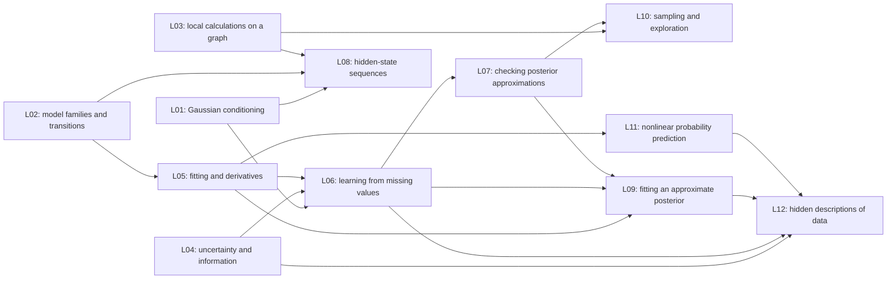

# How the proposed course fits together

The course teaches students to describe a problem with a probability model, work out what they want to know, and choose a computation that answers it. This overview assumes knowledge of probability and lectures 1–4. Book section numbers are lookup information near the end, not required background for reading the explanation.

The instructor agreed to the 13-meeting course order and selected the simpler L03 image algorithm and L04 check-bit example. The remaining detailed choices await instructor review. [Teaching choices](questions_and_hesitations.md) explains the alternatives. [Review records](STATUS.md) separates instructor decisions from what agents have checked.

## What each lecture adds

L01's established Gaussian material and notebook are unchanged. L02's agreed exponential-family and character-sequence work is also unchanged; it is not recorded as delivered. Before producing later teaching material, we must check what L02 actually taught. Its old process notes are not a substitute for that check.

| Meeting | The new question | New ability students gain |
|---|---|---|
| L03 | Graphical models: local calculations in a large model | Turn a probability model into a local calculation and check it against an exact small example. |
| L04 | Information theory: what survives a noisy message? | Build and check a small probability table, and distinguish useful information from a guaranteed correct decision. |
| L05 | Learning models: regression, derivatives and parameter updates | Check automatic derivatives and carry out a simple fit/evaluation loop in PyTorch. |
| L06 | Learning with missing data: expectation-maximization | Use uncertainty about missing values in a parameter update rather than merely fill blanks with best guesses. |
| L07 | Posterior approximation: compare a grid with a Gaussian shortcut | Check a numerical reference and assess the consequences of an approximation. |
| L08 | Sequences: infer hidden states using repeated calculations | Reuse partial calculations to avoid listing an exponentially large set of hidden histories. |
| L09 | Approximate a posterior by fitting a simpler distribution | Compute derivatives through random draws and check an approximation against a known answer. |
| L10 | Sampling: correct transitions and unreliable short runs | Check a sampling rule and diagnose inadequate exploration before trusting an estimate. |
| L11 | Neural prediction: learn a mean and a noise level | Build a probability prediction with a neural network and interpret its uncertainty correctly. |
| L12 | Variational autoencoders: learn a compact hidden description | Combine two networks in one probability model and check how its likelihood and penalty are scaled. |

L13 remains student project presentations. It is not an extra slot for unfinished mathematics.

## Why this order works

L03 connects a graph with a local probability calculation. L04 asks how much an observation tells us and what happens when that observation is noisy or processed. L05 introduces parameter fitting and software-calculated derivatives. Those tools are reused later, rather than reintroduced as new software every time.

L06 explains learning when some values are hidden. It derives a probability bound: a tractable expression that is no larger than the log probability of the observed data. Using the exact conditional distribution of the hidden values makes the bound meet that log probability, which justifies the EM learning step. L09 and L12 reuse this result when the conditional distribution must instead be approximated.

L07 tests a simple Gaussian shortcut to a posterior against a carefully checked numerical grid. L08 shows a different opportunity: some sequence models permit exact calculations without listing all hidden histories. L09 fits a simpler distribution when exact posterior calculation is difficult. L10 estimates quantities by sampling and explains why a mathematically correct chain can still give unreliable short-run estimates.

L11 uses a neural network to make nonlinear predictions and to learn observation noise. L12 combines that network idea with L06's bound and L09's approximate-inference calculation. It learns both a hidden description of an observation and a model that predicts the observation from that description.

We do not make a lecture depend on a method that has not been taught yet. The L03 pixel update does not require later sampling theory. L09 uses independent random draws and an exact regression comparison, so its notebook does not require L10's Markov-chain algorithm. L11 does not claim to infer a posterior over network weights. L12 explains its new inference network rather than assuming that L11 taught it.

An arrow means that the receiving lecture uses an earlier result. The graph shows mathematical dependencies, not all chronological transitions.

## Reuse without repeating whole derivations

Gaussian distributions recur for different reasons. L01 conditions a known model. L06 learns its unknown parameters with missing data. L09 compares an approximate posterior with an exact Gaussian answer. L11 lets the mean and noise change nonlinearly with the input. L12 uses a Gaussian likelihood for observations given hidden coordinates. These are different tasks using a familiar distribution.

The main repeated proofs have one owner. L05 explains automatic derivatives; later lectures apply them. L06 proves the probability-bound identity; L09/L12 reuse it. L09 explains derivatives through random draws; L12 applies that calculation. L04 introduces shared information; L12 studies whether a hidden description actually retains information about data.

## Time and notebook responsibilities

| Meeting | Planned lecture minutes, including 12 for questions/slippage | Notebook minutes | What must be supplied rather than built by students |
|---|---:|---:|---|
| L03 | 112 | 60 | Image data, neighbor handling, update loop, plotting and tiny-model checks |
| L04 | 110 | 60 | Bit arrays, probability-table layout, log-zero handling and plots |
| L05 | 115 | 60 | Data split/scaling, indexing, plotting and training-loop framework |
| L06 | 112 | 60 | Data/masks, matrix checks, update driver and likelihood checks |
| L07 | 110 | 60 | Solver wrapper, grid framework and plots |
| L08 | 112 | 60 | Simulation, exact short-sequence checks, scaling tests and plots |
| L09 | 112 | 60 | Exact comparisons, parameter-update loop, plots and software refresh |
| L10 | 110 | 60 | Stable target calculation, run comparisons and diagnostic helpers |
| L11 | 112 | 60 | Comparison model, training driver, prepared fallback and plots |
| L12 | 112 | 60 | Data transformation, small network definitions, training driver and comparison fits |

The ten plans total 1117 lecture minutes, including 120 reserved for questions/slippage, and 600 notebook minutes. These are estimates, not observed teaching or student completion times. The lighter L04 table reduces calculation without adding material to its existing allowance.

The first PyTorch meeting, the sequence calculations, derivatives through random draws and the final two-network model are the main workload risks. Later PyTorch refreshes are included in the hour. Students complete central mathematical calculations inside supplied programs; the proposal does not promise they will independently build every data loader, solver, diagnostic and training system.

If the real limit is 100 minutes rather than the upper 110–115 minutes used here, actual lecture construction must return the excess to the scope author. Speaking faster or moving work silently to recordings is not a solution. Every section ends by summarizing what it taught; connections are explained at the start of the receiving section. Notebook tasks are a separate lecture-level item.

## What the selected examples give up

The main practical losses are MRI tissue classification, continuous Kalman forecasting, real economic-data regression with unknown noise, and broader neural applications. The current examples are easier to check against a known answer, but give less experience with messy data. That is a visible instructor choice, not an equivalent substitution. Restoring a domain application should replace its corresponding notebook and be reviewed for workload.

Some worthwhile methods are outside this course. Particle methods track a changing hidden state using many weighted samples; they are not taught here. More advanced optimization methods address different geometry or expensive black-box evaluations; basic derivative updates suffice for the selected labs. Bayesian neural networks and Gaussian processes provide other prediction/uncertainty tools, but have no assigned meeting. General graph solvers, more complex regression families, stronger prediction-interval guarantees, architecture surveys and alternative generative models are also omitted. None is quietly deferred to L13 or an unapproved recording.

## Technical checks the authors own

A simpler explanation must preserve the calculation. For example, a parity bit detects but cannot always correct an error. A one-pixel update can stop short of the best image. The most likely entire hidden-state history need not be the list of most likely states considered separately. A correct sampling transition does not certify that a short run explored the distribution.

The later probability objectives must count observations and penalty terms consistently. Standard deviation is not variance. Comparing two model runs requires the same data split, transformations and scoring convention. In L12, expected reconstruction error averages over the hidden-coordinate distribution; decoding its mean is a different visualization. A penalty that keeps hidden distributions close to a reference is not automatically the information those coordinates contain about observations. These checks are explained in the [notebook record](../notebook_reference_audit.md), not presented as questions for the instructor.

## Detailed book map for preparation and checking

The table gives destinations for the main source material. A row marked “not taught” is a deliberate omission, not a reading assignment or a claim of student coverage. “Brief explanation” means a small connection rather than a full derivation or second notebook. Book 2 is Murphy's *Advanced Topics*; Book 1 is *An Introduction*. Exact selected subsections and formulas are also in each scope.

| Book 2 location / subject | Main teaching destination | Extent and limitation |
|---|---|---|
| 4.2 Directed graphs and independence | L03 review | Interpret graph implications; no new graph-learning or causal-calculus course. |
| 4.3.1 / 4.3.2.1 Interactions, normalization and Ising pixels | L03 | Derive a tiny positive pixel model and its normalizing sum. A factor is a score, not itself a normalized conditional probability. |
| 4.3.6 / selected 4.3.8 Independence and image restoration | L03 | Derive the local conditional and one-pixel improvement; no global-best or full-uncertainty guarantee. |
| 4.3.3–5 / 4.3.7 / 4.3.9 Other interaction models and learning | Not taught; small Gaussian comparison optional L03 | Sampling principles are L10 and approximation principles L09. Specialized fitting, feature learning and model approximations are excluded. |
| 4.4 / 4.5 / 4.6 / 4.7 Conditional graphs, comparison, factor graphs, causal models | Factor representation and brief model comparison L03 | No conditional-random-field fitting, general graph conversion, circuits, relational modeling or structural causal-model course. |
| Selected 5.1 / 5.2 Discrepancy, entropy and cross-entropy | L04 | Work finite probability examples; no differential-entropy or geometric-divergence module. |
| 5.3.1–4 Shared information, processing and sufficient summaries | L04 | Derive mutual information, sketch the processing inequality and briefly interpret sufficient statistics. More general information estimators are excluded. |
| 5.4.1 / 5.5 Description length and noisy communication | L04 | State length bounds and work one three-bit parity channel. Guaranteed single-error correction is a stronger referenced result, not the selected lab. |
| 5.4.2 / 5.6 Reconstruction tradeoffs and information bottlenecks | Selected result L12 | Derive why the average prior penalty includes both information and mismatch of pooled hidden codes. No separate full supervised bottleneck or coding theory. |
| 6.1–2 Derivatives and automatic differentiation | L05 | One complete reverse calculation, reused later; no general software framework construction. |
| 6.3.1–2 Batch parameter updates | L05 | Derive the central small-batch update; no optimizer catalogue. |
| 6.3.3–5 Derivatives of random expectations | L09; application L12 | Derive the Gaussian sample-transform route. State an alternative score-based estimator; no full estimator comparison course. |
| 6.3.6–7 Discrete/straight-through gradient methods | Not taught | No Gumbel relaxation, straight-through estimator or general gradient-surrogate toolkit. |
| 6.4 / 6.6–9 Other optimization fields | Not taught | Natural gradients, Bayesian optimization, derivative-free search, transport and submodular selection are excluded, not hidden prerequisites. |
| 6.5.1 / 6.5.3 / 6.5.4 Bound optimization and missing-data EM | L06 | Derive the probability identity, exact-update improvement and Gaussian expected moments. Generalized/stochastic EM and alternative bound methods are excluded. |
| 7.1–3 Inference questions and exact calculation | L07 short overview | Explain what summaries/predictions require; do not teach every inference algorithm. |
| 7.4.1–3 Most likely parameter, grid and Laplace shortcut | L07 | Derive and check a scalar case, including coordinate dependence and numerical-reference limits. |
| 7.4.4–7 Other approximations; 7.5 checks | Methods selected L09/L10; checks L07 | No second implementation in L07; particle methods remain excluded. |
| 8.1.2 / 8.2.2 Gaussian filtering | L08 brief application | Use L01 conditioning. Full smoothing, nonlinear filters, information/square-root variants and learning a dynamic model are excluded. |
| 9.2.1–5 Hidden Markov sequences | L08 | Derive forward/backward calculations, scaling, evidence and computational cost; one main lab. |
| 9.2.6 Whole-history decisions; other model-learning/smoothing extensions | Decision distinction L08 | Full Viterbi mechanics optional; no additional sequence algorithm or parameter-learning lab. |
| 9.1 / 9.3–5 More general graph calculations | Not taught | No general tree solver, variable elimination, junction-tree method or iterative loopy-message algorithm. |
| 10.1.1–2 / 10.1.5 Variational objective and learned inference | L09, with learned inference L12 | Reuse L06 bound; explain family restriction and introduce reuse of an inference network. Other objectives and model-selection recipes excluded. |
| 10.2.1 and selected 10.2 methods | L09 | One Gaussian sample-transform derivative; no full natural-gradient/curvature, discrete-gradient or general black-box toolbox. |
| 10.3.1 Coordinate updates | L09 brief same-target application | No full variational-Bayes EM or expectation-propagation derivation; numerical coordinate sweep optional. |
| 10.4–5 Structured and richer approximations | Not taught | No structured/transformed/mixture family catalogue, flow approximation, message-based variational solver or broader distributed extensions. |
| 11.2–2.2 Monte Carlo integration and error | L10 | Derive independent-sample error and a checked expectation; earlier independent sample averages need no chain theory. |
| 11.3–6 Other Monte Carlo techniques | Not taught | No additional variance-reduction, rejection/importance-sampling or sequential-method lab. |
| 2.6.4 / 12.2.1–2 / 12.3.1–2 Invariant chains, acceptance and Gibbs | L10 | Derive general acceptance correction and brief conditional-coordinate cancellation. |
| 12.5.3 / 12.6.3 Directed Hamiltonian moves and dependent error | Selected L10 | Recognize Hamiltonian mechanics only. Explain query-specific mixing/error under its conditions; no full Hamiltonian theory or automatic convergence certificate. |
| Other Ch.12 advanced samplers; Ch.13 particles | Not taught | No sampler catalogue, tempering/advanced adaptation or particle-tracking curriculum. |
| 15.1 / 15.3.2 Response families and class probabilities | L05 | Substantive Gaussian/Bernoulli/Poisson family comparison, one common derivative and one vector class-probability application. |
| 15.1.2 / 15.2 / 15.3–5 Model extensions | Brief alternative link L05; Gaussian prior L11 | No full sparse/hierarchical/probit/ordinal model inference. Scalar logistic posterior is an L07 example, not full Bayesian regression theory. |
| 14.2 Prediction evaluation | Log probability applied L05/L11 | No full calibration, model-selection or guaranteed-interval module. |
| Selected 16.2 / 16.3.1 Feedforward networks | L11 | One nonlinear conditional mean/noise model; derivatives reused from L05. |
| Other Ch.16 architectures and training extensions | Not taught | No convolutional/recurrent/transformer/graph-network survey, dropout inference or broad normalization/attention theory. Deterministic autoencoder comparison optional L12. |
| 21.1–2 Variational autoencoder | L12 | Model/inference roles, joint objective and updates; apply earlier bound, sample derivative and network likelihood. |
| 21.3.1 / 21.4 Penalty strength and uninformative codes | L12 | Explain rate versus information, collapse cautions and descriptive interpretation; no guaranteed causal/independent factors. |
| 21.3.2–5 / 21.5–6 Other autoencoder models | Not taught | No full information-variational, multimodal, sequential, hierarchical or discrete-code extension. |
| Ch.17–19 / 20 / 22–26 Other prediction/generative fields | Not assigned | Neural networks with a posterior distribution over weights, Gaussian processes, distribution shift and autoregressive/flow/diffusion/adversarial generation require a replacement decision. |
| Selected 3.11 / 28.2.1 Missingness and group assignments | L06 supporting statement/example | Explain when missingness may be ignored and what a group probability means; no second mixture fitting lab. |

Book 1 supports directed-graph review (L03), finite information quantities (L04), derivatives/batch fitting (L05), EM/group explanations (L06) and the input-dependent-noise/weight-shrinkage example (L11). These examples do not make whole Book 1 chapters required or advance a delivered book boundary.

## What has actually been checked

Distinct specialists built and reviewed the original ten scopes. A separate reviewer examined the whole course before reading the coordinator's justification. Those reports supported the original proposal with explicit time/scaffolding risks. The instructor's new L04 choice changes the required code; its previous five-bit review cannot certify the new model. The current readability revisions and changed example are checked separately, with exact targets in [STATUS](STATUS.md).

Textbooks and reference code were inspected. Tiny mathematical examples were checked. Future student notebooks have not been written/executed, and no Google Colab pass or student timing trial is claimed. [Source details](source_inspection.md) identify the inspected material; [validation](validation.md) records document compilation and protection checks. Instructor review remains the next teaching-decision step.
