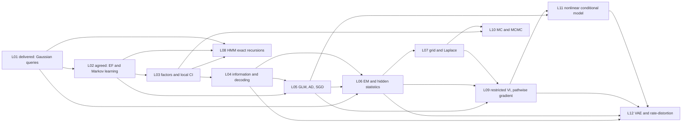

# L03–L12 whole-course architecture audit

**Proposal:** agent-reviewed / instructor-pending, 2026-10-11. Branch `scope-l03-l12-course-architecture`. Instructor architecture: main `b78a7650bb09ae851e412089d98525f7b71275d9` (PR #8). Execution began at `906ce71dd9c8e29f3dede51ec809442a885354c9`. Exact scope/review revisions and gates are in [STATUS.md](STATUS.md). This audit owns allocation, dependencies and consistency; lecture-local scopes own their five-part intellectual commitments. No new scope is instructor-approved.

## Protected boundary and overall argument

L01's actual Gaussian/LGS deck, missing-data solution and delivered ledger remain unchanged. L02's agreed exponential-family/Markov-learning section contract remains unchanged and undelivered in accounting. Its malformed/stale development-state file is not treated as new authority. The contract assumes L02's promised results are taught before L03; reconcile actual delivery before implementation. No new lecture is assigned to L13 projects.

The course moves from representations and information to fitted conditional models, hidden-data learning, inference and neural latent models. L03 asks what a factorization makes locally computable; L04 asks what information survives noise/processing; L05 learns a conditional model; L06 learns when sufficient statistics are hidden; L07 measures approximation error; L08 exploits exact structure; L09 restricts posterior families; L10 studies correct chains and unreliable finite estimates; L11 makes nonlinear conditional predictions; L12 learns a generative model and approximate inference map jointly.

Repeated Gaussian objects have different jobs: L01 known-parameter conditioning, L06 unknown-parameter missing-data EM, L09 restricted approximation to a known-noise regression posterior, L11 nonlinear mean/scale prediction, L12 local latent-variable generation. These are deliberate reuse, not five independent Gaussian derivations.

## Primary source ownership and treatment

`Deep` means Derive/Prove/Work as specified in the scope; `bridge` means bounded State/Apply/recognition. Reading ranges do not promise every subsection. All allocations below are proposed future coverage, never changes to delivered dispositions.

| Murphy Book 2 source / central concept | Primary owner and actual treatment | Named limit / exclusion |
|---|---|---|
| 4.2 DAG factorization, d-separation, blankets | L03 compact recall/work; graphical entailment versus numerical independence | No full Bayes-ball, BN learning or causal calculus |
| 4.3.1 positive MRF factors, energy, partition function | L03 deep tiny-square normalization | Positivity qualifies converse Markov equivalences; potentials are not CPDs |
| 4.3.2.1 Ising;4.3.6 CI; selected4.3.8 restoration model | L03 deep conditional cancellation/odds and coordinate MAP | Potts only optional mention; no exact joint-MAP or marginal guarantee from ICM |
| 4.3.3–5,4.3.7/9 specialized models, sampling/learning | GMRF optional L03; sampling mathematics L10, VI L09 | RBMs, feature induction, INLA, pseudolikelihood and MRF fitting omitted |
| 4.4 CRFs;4.5 model comparison;4.6 factor graphs;4.7 causal models | Factor incidence and bounded directed/undirected distinction L03 | Full CRF/conversion/label-bias/circuits/relational/SCM methods omitted |
| 5.1 selected KL and5.2.1/4 finite entropy/cross-entropy | L04 operational consolidation, identity and worked mismatch | No uniqueness axioms, Fisher/Bregman geometry, differential-entropy/AEP module |
| 5.3.1–4 MI, DPI, sufficiency | L04 MI derivation, DPI sketch, bounded sufficiency equality | Conditional MI only proof support; no multivariate/variational-MI catalogue |
| 5.4.1 source length;5.5 channel coding | L04 states prefix-code bounds, deeply works one five-bit channel | No Huffman, coding/capacity theorem proof or second lab; source XOR optional |
| 5.4.2 rate–distortion;5.6 IB | L12 deep average-KL rate decomposition and beta tradeoff | Full supervised IB/InfoVAE/bits-back/algorithmic information omitted |
| 6.1–2 differentiable objectives/reverse AD | L05 one complete shared-intermediate graph; L11/L12 reuse | No full functional/JVP/VJP/program-differentiation theory |
| 6.3.1–2 finite-sum/minibatch SGD | L05 primary derivation/application and first PyTorch lab | No optimizer/convergence-rate catalogue |
| 6.3.3–5 distribution expectations/estimators | L09 Gaussian total pathwise gradient deep; score function stated | L12 applies; Gumbel/straight-through/stochastic-graph catalogue omitted |
| 6.4 natural gradients;6.6–9 BO/DFO/transport/submodularity | Deliberate course omissions | Not future debt or unapproved recordings |
| 6.5.1,3–4 MM/EM and missing MVN | L06 generic F/KL/tightness/monotonicity and uncertainty-preserving moments deep | Logistic MM, robust/online/MC/ECM EM and full second GMM derivation omitted |
| 7.1–3 queries/patterns/exact possibilities | L07 short framing grounded in one posterior | No repeated broad task taxonomy |
| 7.4.1–3 MAP/grid/Laplace; selected7.5 checking | L07 scalar Taylor/normalizer/curvature deep; grid checks lab | No asymptotic proof, multimode/INLA catalogue or exact-grid-truth claim |
| 7.4.4–6 VI/MCMC/SMC overview | Recognition L07; primary VI L09, MCMC L10 | Substantive Ch13 SMC omitted; no broad7.4.7 tour |
| 8.1.2/8.2.2 Bayesian/Kalman filtering | L08 compact14-minute Apply/Work from L01 conditioning | No Kalman lab, RTS, information filter, EKF/UKF/ensemble/ADF catalogue |
| 9.2.1–5 HMM forward/backward/scaling/complexity | L08 deep recursions/smoothing, exact oracle and NumPy lab | Dense O(TK²), not brute-force exponential enumeration at scale |
| 9.2.6 Viterbi and marginal/path decisions | L08 decision distinction; mechanics optional | No second full max-product derivation; general trees/loopy BP/VE/JTA omitted |
| 10.1.1–2 restricted VI/reverse KL | L09 deep Gaussian geometry; L06 generic identity reused | Factorization of q does not imply independence in the true posterior |
| 10.2.1 and6.3.5 pathwise Gaussian objective | L09 primary total derivative/regularity; L12 application | No ADVI transform catalogue or score-estimator implementation |
| 10.3 CAVI;10.1.5 amortization | Bounded CAVI same-target application L09; operational amortization L12 | No full CAVI functional proof/VBEM/Ising solver;10.4–7 flows/IWAE/EP/wake-sleep omitted |
| 11.2 IID integration/variance | L10 deep estimator uncertainty; operational latent-draw average L09 | Rigorous-probability LLN background; no pre-L10 MCMC requirement |
| 11.4/5 rejection/importance | L10 brief contrast/state only | No implementation module, inverse-CDF/Box–Muller/AIS/variance-reduction catalogue |
| 2.6.4 and12.2 stationarity/MH | L10 deep balance/acceptance and bounded convergence assumptions | L02 stopped before stationarity; rejection repeats are part of the kernel |
| 12.3 Gibbs;12.6 mixing/ESS/error | L10 bounded Gibbs cancellation, stationary variance and query-specific diagnostics | No certificate from acceptance/ESS/burn-in; stronger CLT conditions stated |
| 12.5 HMC | L10 recognition/mechanics only, leveraging undergraduate NUTS use | Full theory/leapfrog proof/implementation omitted; no false L09 deferment |
| 12.4/7–9 auxiliary/SG/RJ/annealing MCMC | Deliberate omissions | No debt to neural/VAE lectures |
| 15.1 family/links/canonical gradient;15.3.2 softmax | L05 substantive Gaussian/Bernoulli/Poisson comparison, one scalar gradient and separate vector application | Rank/separation qualify finite MLE claims; no Hessian/IRLS/general Bayesian GLM |
| 15.3.5–6 logistic Laplace/predictive integral | Selected scalar L07 application | No full multiclass posterior/frogs case study |
| 15.2 priors;14.2 scoring | L11 narrow Gaussian-prior/mean-loss L2 connection; log scores L04/L05/L11 | Sparse/lasso/horseshoe/selection/calibration/conformal units omitted |
| 15.4–5 probit/ordinal/hierarchical GLMs | Noncanonical-link recognition L05 only | No substantive model-family extensions |
| 16.2.1–2/16.3.1 MLPs | L11 deep nonlinear conditional mean/SD and NLL, AD reused | CNN/RNN/transformer/GNN/dropout/norm/attention theory omitted |
| 16.3.3 autoencoder context | Optional L12 comparison | No separate deterministic-AE lab or architecture survey |
| 21.1–2 VAE basics | L12 model/q roles, joint objective/gradients, one tabular lab | Generic ELBO L06, pathwise math L09 and network loss L11 reused |
| 21.3.1 beta;21.4 collapse | L12 rate versus MI identity and cautious diagnostics | No identified/causal factor guarantee; annealing Mention only |
| 21.3.2–5/21.5–6 extensions | Deliberate omissions | No InfoVAE, multimodal/sequential/hierarchical/VQ VAE or multiple full fits |
| Ch17–19 and20/22–26 additional prediction/generation fields | Not assigned in this13-meeting architecture | BNN/GP/shift and autoregressive/flow/diffusion/GAN methods require a displacement decision |

**Book 1 is selective support:** L03§§3.6.1–2 DAG recall; L04 finite entropy/MI/DPI exposition; L05 selected matrix calculus/SGD; L06 mixture/responsibility and EM exposition; L11§13.2.4.4 heteroskedastic example and§13.5.2 weight decay. Other overlap is not another required chapter. Full references and source limits live in the scopes and [source_inspection.md](source_inspection.md).

## Prerequisite graph and backward-reference audit

There is no algorithmic backward dependency. L03's ICM does not require L09/10; L08's exact messages do not require VI/MCMC; L09 uses independent standard-Normal draws and a probability-level sample-mean expectation, not HMC/chain error theory; L11 conditions on fitted weights and does not claim BNN inference. L12 adds encoder construction rather than assuming it was taught in L11. L05's canonical coordinate is locally distinguished from full model parameters in later lectures.

One actual source-depth mismatch was repaired: L09's deferred “HMC theory” row now promises only L10 mechanics/recognition and names full theory as omitted. Original and targeted independent evidence is preserved in L09_review.md. L11's original build cited the earlier L09 blob; its reviewer checked the current handoff and confirmed the only change was unrelated HMC wording. No neural prerequisite or content approval was invalidated.

## Notebook skill sequence and workload

| Lecture | One completion endpoint / durable skill | New tools or assumptions; supplied infrastructure | Inclusive live / lab estimate |
|---|---|---|---:|
| L03 | Checked local conditional and coordinate restoration | NumPy reused; image/edge/sweep/plot helpers; tiny exact oracle |112 /60 |
| L04 | Complete coded channel, MI and Bayes block risk | NumPy reused; bit arrays/axes/log-zero helpers and sweep plots |110 /60 |
| L05 | Three-class Iris fit, manual/autograd gradient, held-out log loss | First PyTorch; data split/scaling/index/plots supplied |115 /60 |
| L06 | Expected moments and alternating Gaussian estimator | NumPy solves reused; masks/SPD data/driver/objective checker supplied |112 /60 |
| L07 | Domain/resolution-challenged grid versus Laplace | SciPy solver wrapper/grid/plots supplied; no VI/MH coding |110 /60 |
| L08 | Scaled forward/backward and sequence marginals | NumPy reused; simulation/oracles/plots supplied; asymmetric-A check required |112 /60 |
| L09 | Diagonal q fitted through sample transform and exact reference | PyTorch refresh10min included; driver/reference/plots supplied |112 /60 |
| L10 | Checked MH kernel, proposal/start/query mixing comparison | NumPy reused; stable log target/diagnostics/harness supplied |110 /60 |
| L11 | One nonlinear mean/SD fit and conditional intervals | PyTorch refresh included; baseline/model driver/checkpoints supplied |112 /60 |
| L12 | One joint VAE objective/update run and beta/rate interpretation | PyTorch refresh10min included; data/model/driver and normalized comparison fits supplied |112 /60 |

Future L03–L12 total:1117 live minutes including120 reserve, plus600 lab minutes. These are estimated envelopes, not measured student pace or runtime. Each local reviewer bounded its concern to the real new derivations and promised scaffolding. L01's61-content-slide anchor is a provisional density prior, not a universal conversion or an implementation validation. Every new lecture is tight; optional examples are first cuts, not required recordings. No required recording was introduced.

Only PyTorch is a new required ecosystem, introduced L05 and refreshed later. NumPy/SciPy/Matplotlib support checks; scikit-learn may load/preprocess supplied data but is not a new algorithm curriculum. PyMC/Bambi/ArviZ are prior skills, not repeated routine labs. Pyro, JAX/Dynamax and TFP source implementations are not student dependencies. Checkpoints, data packaging and helper correctness remain real production work, not already existing course deliverables.

## Cross-lecture safeguards and genuine losses

The canonical bound is F=E log joint+entropy; log evidence=F+KL(q||posterior). Exact EM supplies tightness, restricted VI generally does not. L05 mean empirical NLL is not L09's summed-data Bayesian likelihood: sum observations/average latent draws, or scale the entire objective together. L11 mean-loss Gaussian-prior coefficient includes N. L12 sums observed/latent event axes separately, then averages observations; fixed decoder variance determines reconstruction scaling. L04 uses bits, later loss formulas use nats, converted by ln2. A variance is never passed as a Normal SD.

Source discrepancies are explicit: XOR correction claims, graph connection versus universal dependence, HMM joint versus marginal modes, Berkeley accuracy prose, VI sign/constants, and heteroskedastic SD/variance. Required exact examples are course-constructed or accurately source-inspected; no new Murphy figure or notebook output is attributed without verification.

Practical losses are real: no full MRI/GMM fit, Kalman forecasting lab, real-GDP unknown-noise VI-versus-HMC comparison, standalone regularized-digits/Poisson lab, full HMC theory, BNN posterior uncertainty or broad calibration. Controlled cases improve exact checking but reduce empirical breadth. Mobility is retained as the final empirical application, with approximate standardized-Gaussian modeling/descriptive interpretation and unresolved distribution access. These choices are collected with alternatives/cost in [questions_and_hesitations.md](questions_and_hesitations.md).

Every resulting section must end retrospectively; receiving sections own connections. Notebook handoffs remain separate lecture-level items. Scope-stage arithmetic checks and independent feasibility are not Section Design construction, rehearsal, clean-kernel execution or Colab compatibility. Future authoring must validate worked solutions and run local uv plus clean hosted Colab before publication.

## Review, reconciliation and formal-output gates

Wave A: L03–L05 representations/information/trainable conditionals; independent reviews passed and source-depth/budget handoffs reconciled. Wave B: L06–L08 hidden statistics/approximation/exact structure; independent reviews passed, no second EM or sequence implementation. Wave C: L09–L12 stochastic gradients/sampling/neural synthesis; generic proof ownership is protected and HMC overpromise repaired. Exact authors, reviewers, scope versions and approval states are in STATUS, with full raw evidence under reviews/.

Independent adversarial whole-course gate: pending. Formal syllabus, plan, material ledger, notebook audit and planning decisions will be synchronized only after that gate settles. Delivered ledger boundaries and L01/L02 artifacts are protected. Two Typst files must compile;13 meeting numbers/dates, local links, source-depth promises and exact revision bindings must be checked. Final validation evidence will be committed separately from any notebook-runtime claim.
